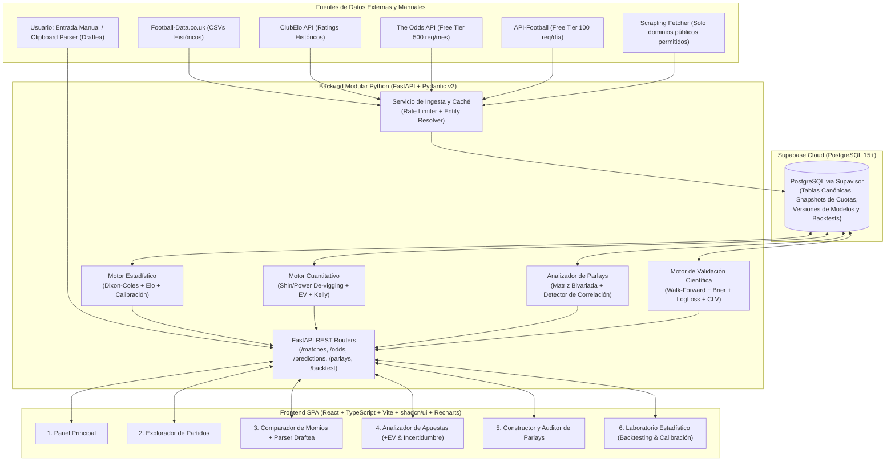

# 04. Arquitectura Tecnológica y Esquema de Datos

## 1. Clasificación del Documento
- **Información Verificada:** Patrones de arquitectura modular de `FastAPI` (`APIRouter`, inyección de dependencias con `SessionDep` y `SQLModel`/`SQLAlchemy 2.0`), modos de conexión de `Supabase` (`Supavisor` en puerto `5432` para *Session Mode* vs `6543` para *Transaction Mode*) y componentes declarativos de `Recharts` verificados mediante **Context7**.
- **Decisiones Aprobadas:** Stack **React + TypeScript + Vite + Tailwind + shadcn/ui + Recharts** en Frontend; **Python + FastAPI + Pydantic v2 + SQLModel** en Backend; **Supabase (PostgreSQL Cloud Free Tier)** como capa de persistencia desde el Día 1.

---

## 2. Diagrama de Arquitectura del Sistema



---

## 3. Justificación Técnica del Stack Elegido

### 3.1 Persistencia en Supabase (PostgreSQL Cloud)
- **Por qué Supabase frente a SQLite puro:** Permite acceder al dataset histórico, a las cuotas capturadas de Draftea y a los experimentos de modelos desde cualquier máquina sin mover archivos `.db` locales, manteniendo un motor PostgreSQL empresarial real desde el día 1.
- **Configuración de Conexión Verificada (Context7 `/websites/supabase_guides`):**
  - Para migraciones (`Alembic`) y el backend persistente en `FastAPI` con `SQLAlchemy 2.0 / SQLModel`, utilizaremos la cadena de conexión del **Session Pooler (`Supavisor` en puerto `5432`)** con prefijo `postgresql+psycopg://`, lo cual garantiza compatibilidad total con IPv4, *prepared statements* y transacciones ACID.
- **Inmutabilidad Temporal (Append-Only Odds Snapshots):**
  - Los momios **nunca se sobrescriben** con un `UPDATE`. Cada captura (ya sea de The Odds API o manual de Draftea) se inserta como un nuevo registro en `odds_snapshots` con su sello `captured_at (TIMESTAMPTZ)`. Esto permite auditar cómo se movió la línea hasta el cierre (*Closing Line*) y garantiza **Cero Fuga de Información Futura** en el backtesting.

### 3.2 Backend en Python (FastAPI + Pydantic v2 + SQLModel)
- **Separación Estricta de Capas:**
  1. `routers/`: Solo manejo HTTP, validación de esquemas y códigos de estado.
  2. `services/ingestion/`: Conectores desacoplados mediante una interfaz base `BaseDataProvider`. Agregar un nuevo proveedor no toca la lógica estadística.
  3. `services/models/`: Implementa la interfaz `BasePredictiveModel` (`fit(train_df, as_of_date)`, `predict_proba(match_context)`). Esto permite que el modelo `DixonColesEloModel` de fútbol hoy y un futuro `NBASpreadModel` en Fase 7 compartan la misma tubería de evaluación.
  4. `services/quant/`: Funciones matemáticas puras (sin estado ni acceso a BD), 100% testeables con pruebas unitarias deterministas (`de-vigging`, cálculo de $EV$, Kelly fraccionario y matriz conjunta de parlays).

### 3.3 Frontend en React + TypeScript + Vite + Tailwind + shadcn/ui + Recharts
- **Por qué Vite SPA frente a Next.js SSR:** Al tratarse de un dashboard analítico e interactivo conectado a un backend en FastAPI, no necesitamos SEO ni Server-Side Rendering en Node.js. Vite reduce la complejidad operativa, acelera la compilación en local y mantiene una separación limpia entre cliente (TypeScript) y servidor científico (Python).

---

## 4. Esquema Relacional de Base de Datos (Supabase PostgreSQL)

El diseño soporta **Fútbol** en el MVP y es nativamente extensible a **NBA y NFL** gracias a la parametrización de deportes y mercados:

```sql
-- 1. Catálogo de Deportes y Competiciones
CREATE TABLE competitions (
    id UUID PRIMARY KEY DEFAULT gen_random_uuid(),
    sport_code VARCHAR(20) NOT NULL, -- 'FOOTBALL', 'NBA', 'NFL'
    code VARCHAR(30) UNIQUE NOT NULL, -- 'LIGA_MX', 'LA_LIGA', 'EPL', 'UCL', 'MLS'
    name VARCHAR(100) NOT NULL,
    country VARCHAR(60),
    has_draws BOOLEAN NOT NULL DEFAULT TRUE,
    is_active BOOLEAN NOT NULL DEFAULT TRUE
);

-- 2. Equipos Canónicos y Alias Multi-Fuente
CREATE TABLE teams (
    id UUID PRIMARY KEY DEFAULT gen_random_uuid(),
    sport_code VARCHAR(20) NOT NULL,
    canonical_name VARCHAR(120) NOT NULL,
    short_code VARCHAR(15),
    country VARCHAR(60),
    UNIQUE (sport_code, canonical_name)
);

CREATE TABLE team_aliases (
    id UUID PRIMARY KEY DEFAULT gen_random_uuid(),
    team_id UUID NOT NULL REFERENCES teams(id) ON DELETE CASCADE,
    source_provider VARCHAR(40) NOT NULL, -- 'FOOTBALL_DATA_UK', 'THE_ODDS_API', 'API_FOOTBALL', 'CLUB_ELO', 'DRAFTEA'
    alias_name VARCHAR(150) NOT NULL,
    UNIQUE (source_provider, alias_name)
);

-- 3. Partidos (Históricos y Próximos)
CREATE TABLE matches (
    id UUID PRIMARY KEY DEFAULT gen_random_uuid(),
    competition_id UUID NOT NULL REFERENCES competitions(id),
    season VARCHAR(20) NOT NULL, -- ej. '2025-2026'
    stage_type VARCHAR(30) NOT NULL DEFAULT 'REGULAR_SEASON', -- 'REGULAR_SEASON', 'PLAYOFF_LEG_1', 'PLAYOFF_LEG_2', 'FINAL_NEUTRAL'
    kickoff_time TIMESTAMPTZ NOT NULL,
    status VARCHAR(20) NOT NULL DEFAULT 'SCHEDULED', -- 'SCHEDULED', 'FINISHED', 'POSTPONED'
    home_team_id UUID NOT NULL REFERENCES teams(id),
    away_team_id UUID NOT NULL REFERENCES teams(id),
    is_neutral_venue BOOLEAN NOT NULL DEFAULT FALSE,
    home_score INT,
    away_score INT,
    home_xg NUMERIC(5,2),
    away_xg NUMERIC(5,2),
    metadata_json JSONB DEFAULT '{}'::jsonb, -- tiros, córners, lesionados verificados pre-partido
    created_at TIMESTAMPTZ NOT NULL DEFAULT NOW(),
    CONSTRAINT chk_different_teams CHECK (home_team_id <> away_team_id)
);

CREATE INDEX idx_matches_kickoff ON matches(kickoff_time);
CREATE INDEX idx_matches_comp_season ON matches(competition_id, season);

-- 4. Snapshots Inmutables de Momios (API + Entrada Manual Draftea)
CREATE TABLE odds_snapshots (
    id UUID PRIMARY KEY DEFAULT gen_random_uuid(),
    match_id UUID NOT NULL REFERENCES matches(id) ON DELETE CASCADE,
    bookmaker_code VARCHAR(40) NOT NULL, -- 'PINNACLE', 'BET365', 'DRAFTEA', 'MARKET_AVG'
    source_type VARCHAR(30) NOT NULL, -- 'THE_ODDS_API', 'FOOTBALL_DATA_CSV', 'MANUAL_FORM', 'CLIPBOARD_PARSER'
    market_type VARCHAR(30) NOT NULL, -- '1X2', 'DOUBLE_CHANCE', 'OVER_UNDER', 'BTTS', 'SPREAD', 'MONEYLINE_2WAY'
    line_value NUMERIC(5,2), -- NULL para 1X2/BTTS; 2.5 para O/U 2.5; -3.5 para Spreads
    selection_code VARCHAR(20) NOT NULL, -- 'HOME', 'DRAW', 'AWAY', 'OVER', 'UNDER', 'YES', 'NO', '1X', '12', 'X2'
    decimal_odds NUMERIC(8,4) NOT NULL CHECK (decimal_odds > 1.0),
    captured_at TIMESTAMPTZ NOT NULL DEFAULT NOW(),
    is_closing_line BOOLEAN NOT NULL DEFAULT FALSE
);

CREATE INDEX idx_odds_match_market_time ON odds_snapshots(match_id, market_type, captured_at DESC);

-- 5. Registro de Versiones de Modelos y Predicciones Pre-Partido
CREATE TABLE model_versions (
    id UUID PRIMARY KEY DEFAULT gen_random_uuid(),
    model_name VARCHAR(60) NOT NULL, -- 'DIXON_COLES_ELO_V1'
    version_tag VARCHAR(30) NOT NULL UNIQUE,
    sport_code VARCHAR(20) NOT NULL,
    hyperparameters JSONB NOT NULL,
    calibration_method VARCHAR(30) NOT NULL, -- 'ISOTONIC', 'PLATT', 'NONE'
    trained_up_to TIMESTAMPTZ NOT NULL,
    created_at TIMESTAMPTZ NOT NULL DEFAULT NOW()
);

CREATE TABLE model_predictions (
    id UUID PRIMARY KEY DEFAULT gen_random_uuid(),
    match_id UUID NOT NULL REFERENCES matches(id) ON DELETE CASCADE,
    model_version_id UUID NOT NULL REFERENCES model_versions(id),
    generated_at TIMESTAMPTZ NOT NULL DEFAULT NOW(),
    market_type VARCHAR(30) NOT NULL,
    line_value NUMERIC(5,2),
    selection_code VARCHAR(20) NOT NULL,
    predicted_prob NUMERIC(6,5) NOT NULL CHECK (predicted_prob >= 0 AND predicted_prob <= 1),
    prob_ci_low NUMERIC(6,5),  -- Límite inferior de incertidumbre (90%)
    prob_ci_high NUMERIC(6,5), -- Límite superior de incertidumbre (90%)
    score_matrix_json JSONB,   -- Matriz 10x10 P(X=i, Y=j) para cálculo exacto de parlays correlacionados
    explanation_factors JSONB  -- Factores explicativos (lambda_home, lambda_away, elo_diff, rho)
);
```

---

## 5. Contratos de Datos Principales (Pydantic v2)

Todos los intercambios entre el motor cuantitativo y el frontend están gobernados por esquemas estrictos en Pydantic v2:

```python
from datetime import datetime
from typing import Literal
from pydantic import BaseModel, Field

MarketType = Literal["1X2", "DOUBLE_CHANCE", "OVER_UNDER", "BTTS", "SPREAD", "MONEYLINE_2WAY"]
DevigMethod = Literal["SHIN", "POWER", "MULTIPLICATIVE"]

class MarketSelectionEvaluation(BaseModel):
    selection_code: str
    bookmaker_code: str
    decimal_odds: float = Field(gt=1.0)
    raw_implied_prob: float = Field(ge=0.0, le=1.0)
    bookmaker_overround: float
    fair_market_prob: float = Field(ge=0.0, le=1.0)
    devig_method: DevigMethod
    model_prob: float = Field(ge=0.0, le=1.0)
    model_ci_low: float = Field(ge=0.0, le=1.0)
    model_ci_high: float = Field(ge=0.0, le=1.0)
    edge_vs_fair: float
    expected_value_nominal: float
    expected_value_conservative: float # Calculado usando model_ci_low o encogimiento Bayesiano
    recommended_kelly_fraction: float = Field(ge=0.0, le=0.05) # Tope estricto <= 5%
    signal_classification: Literal["NO_EDGE", "HIGH_UNCERTAINTY", "CANDIDATE_VALUE"]
```
