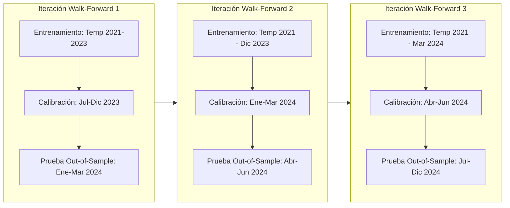

# 06. Validación Científica y Protocolo de Backtesting

## 1. Clasificación del Documento
- **Información Verificada:** Reglas de partición temporal estricta (`TimeSeriesSplit` / *Walk-Forward*), funciones de puntuación estrictamente propias (*Strictly Proper Scoring Rules*: **Log-Loss** y **Brier Score**), **Curvas de Calibración** (verificadas en `scikit-learn` vía Context7 `/websites/scikit-learn_stable`) y **Closing Line Value (CLV)**.
- **Principio Rector:** Ningún modelo pasa a producción en el analizador principal si no supera los criterios cuantitativos de aceptación definidos en este documento. Si los datos muestran que no existe ventaja estadística sobre el mercado, el sistema debe reportarlo sin adornos.

---

## 2. Prevención Estricta de Fuga de Información Futura (*Zero Data Leakage*)

El sesgo más destructivo en el modelado deportivo es utilizar inadvertidamente información posterior al inicio del partido durante el entrenamiento o la inferencia histórica.

### Reglas de Invarianza Temporal (*Point-in-Time Correctness*)
Para evaluar un partido $m$ con fecha y hora de inicio $T_{\text{kickoff}}(m)$:
1. **Corte de Entrenamiento (`as_of_timestamp`):** El conjunto de entrenamiento $\mathcal{D}_{\text{train}}$ solo puede contener partidos cuyo estado sea `FINISHED` y cuya hora de finalización $T_{\text{end}} < T_{\text{kickoff}}(m)$.
2. **Prohibición de Estadísticas Globales de Temporada:** Queda prohibido calcular promedios de goles o $xG$ "de toda la temporada 2024-2025" y usarlos para predecir un partido de la Jornada 5 de esa misma temporada. Toda variable agregada (*rolling window*) se calcula exclusivamente con el subconjunto $\{k : T_{\text{end}}(k) < T_{\text{kickoff}}(m)\}$.
3. **Corte de Cuotas (*Odds Snapshot Cut-Off*):** Al simular una estrategia pre-partido, solo pueden evaluarse registros de `odds_snapshots` con `captured_at <= T_kickoff(m)`.
4. **Calibración Fuera de Muestra:** El calibrador isotónico o sigmoide (`CalibratedClassifierCV` / `IsotonicRegression`) se ajusta sobre una ventana de validación cronológica pasada $[T_1, T_2)$ y **jamás** sobre la ventana de prueba $[T_2, T_3]$.

---

## 3. Esquema de Validación Walk-Forward (Ventana Expandible)

- El motor se re-estima periódicamente (ej. cada jornada o cada 7 días de calendario simulado) incorporando los nuevos partidos finalizados, replicando exactamente cómo habría operado el sistema en tiempo real.

---

## 4. Métricas de Evaluación Probabilística y de Mercado

### 4.1 Reglas de Puntuación Estrictamente Propias (*Proper Scoring Rules*)
1. **Multiclass Brier Score (para `1X2`) y Binary Brier Score (para `Over/Under` y `BTTS`):**
   $$\text{BS} = \frac{1}{N} \sum_{n=1}^{N} \sum_{c=1}^{C} \left( p_{n, c} - y_{n, c} \right)^2$$
   Donde $y_{n, c} \in \{0, 1\}$ es el indicador del resultado observado. Menor es mejor.
2. **Log-Loss (Entropía Cruzada Logarítmica):**
   $$\text{LogLoss} = -\frac{1}{N} \sum_{n=1}^{N} \sum_{c=1}^{C} y_{n, c} \ln\big(\max(\epsilon, p_{n, c})\big)$$
   Penaliza severamente las predicciones con exceso de confianza que resultan erróneas.
3. **Ranked Probability Score (RPS — Específico para resultados ordenados de Fútbol `1-X-2`):**
   Toma en cuenta el orden natural Victoria Local $\to$ Empate $\to$ Victoria Visitante (predecir Local cuando gana Visitante es un error más grave que cuando empatan):
   $$\text{RPS} = \frac{1}{C - 1} \sum_{r=1}^{C - 1} \left( \sum_{j=1}^{r} p_j - \sum_{j=1}^{r} y_j \right)^2$$
4. **Expected Calibration Error (ECE) y Curvas de Fiabilidad:**
   Agrupa las predicciones en $B=10$ cubetas (*bins*) de probabilidad y mide la distancia ponderada entre la probabilidad media predicha y la frecuencia empírica real:
   $$\text{ECE} = \sum_{b=1}^{B} \frac{|I_b|}{N} \left| \text{acc}(I_b) - \text{conf}(I_b) \right|$$

### 4.2 Métricas Financieras y de Eficiencia de Mercado (Simuladas / Sin Dinero Real)
1. **Closing Line Value (CLV):**
   Compara la cuota tomada en el momento $t$ ($O_{\text{taken}}$) contra la probabilidad justa sin margen de la línea de cierre de Pinnacle ($p_{\text{close}}^{\text{shin}}$):
   $$\text{CLV} = O_{\text{taken}} \cdot p_{\text{close}}^{\text{shin}} - 1$$
   > [!IMPORTANT]
   > En mercados deportivos, el **CLV promedio en $\ge 500$ selecciones** es el indicador más rápido y fiable de capacidad predictiva real antes de que la varianza del ROI converja.
2. **ROI Simulado con Intervalo de Confianza Bootstrap y Valor-$p$:**
   - Cálculo de $\text{ROI} = \frac{\text{Beneficio Neto en Unidades}}{\text{Total de Unidades Arriesgadas}}$.
   - Cálculo del estadístico $t$ de Student y simulación de Monte Carlo sobre la historia de apuestas para estimar la **Probabilidad de que el ROI observado sea puro azar ($p\text{-value}$)** y el **Maximum Drawdown (Caída Máxima)**.

---

## 5. Modelos Base de Referencia (*Benchmarks Obligatorios*)

Todo modelo candidato debe compararse en tabla contra 3 referencias:
1. **Benchmark 1 (Climatológico / Frecuencia Histórica de la Liga):** Asigna siempre el porcentaje histórico de victorias locales, empates y victorias visitantes de esa liga (ej. 45% Local, 27% Empate, 28% Visitante).
2. **Benchmark 2 (Elo Puro):** Probabilidades derivadas únicamente del diferencial Elo más ventaja de localía constante.
3. **Benchmark 3 (Mercado Sharp De-Vigged — Techo de Referencia):** Probabilidades implícitas de cierre de Pinnacle ajustadas por el método de Shin.

---

## 6. Criterios de Aceptación y Regla de Parada Científica

Antes de habilitar cualquier indicador de valor en el Dashboard Principal para una liga y mercado dados, el modelo debe cumplir en el conjunto de prueba *Walk-Forward* ($\ge 300$ partidos por liga):
1. **Superar con significancia estadística ($p < 0.05$ en test de Diebold-Mariano)** al *Benchmark 1 (Climatológico)* y al *Benchmark 2 (Elo Puro)* tanto en **Log-Loss** como en **RPS / Brier Score**.
2. **Calibración Saludable:** Obtener un $\text{ECE} \le 0.035$ (desviación media de calibración menor al 3.5%).
3. **Transparencia ante Falta de Edge:** Si en una liga/mercado el modelo tiene un Log-Loss significativamente peor que el *Benchmark 3 (Mercado Sharp)* y un CLV negativo en pruebas históricas, el sistema mostrará un banner preventivo en ese mercado: *"Evidencia histórica insuficiente de ventaja sobre el mercado eficiente en esta competición — Usar solo con fines exploratorios"*.
