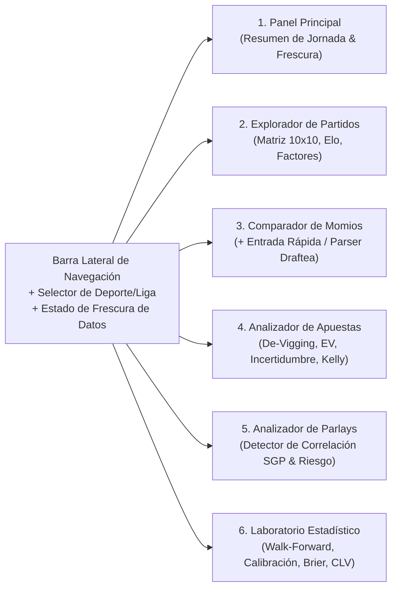

# 07. Diseño de la Interfaz y Experiencia de Usuario (UX/UI)

## 1. Clasificación del Documento
- **Información Verificada:** Capacidades de componentes accesibles de `shadcn/ui` (basados en Radix UI + Tailwind CSS) y gráficas declarativas compuestas en `Recharts` (`ResponsiveContainer`, `ComposedChart`, `ReferenceLine`, `Area`, `Scatter`) verificadas mediante **Context7** (`/recharts/recharts`).
- **Principio de Diseño:** Estética **Cuantitativa de Bajo Ruido Visual** (inspirada en terminales financieras modernas como Linear, Bloomberg Lite o TradingView), en modo oscuro nativo (`Slate/Zinc Dark`), con diferenciación visual estricta entre **Hechos Observados**, **Estimaciones del Modelo** y **Simulaciones**.

---

## 2. Sistema Semántico de Diferenciación Epistemológica

Para evitar cualquier confusión cognitiva en el usuario, toda cifra o tarjeta en la interfaz lleva una codificación visual consistente:

| Categoría | Etiqueta UI (Badge) | Estilo Visual | Ejemplos en la Interfaz |
| :--- | :--- | :--- | :--- |
| **Hecho Observado** | `[OBSERVADO]` | Texto sólido neutro (`text-slate-100`), borde continuo, acompañado siempre de su timestamp `captured_at`. | Resultados pasados (`2-1`), cuota actual en Draftea (`2.15 @ 11:40h`), probabilidad implícita bruta (`46.5%`), margen de la casa (`6.4%`). |
| **Estimación del Modelo** | `[ESTIMACIÓN MODELO v1.x]` | Acento índigo/cian (`text-sky-400`), acompañado siempre de su rango de incertidumbre $[p_{\text{low}}, p_{\text{high}}]$. | Probabilidad Dixon-Coles (`51.2% [47.8% - 54.6%]`), goles esperados ($\lambda = 1.68, \mu = 1.05$), $EV$ conservador (`+3.1%`). |
| **Simulación / Backtest** | `[SIMULACIÓN SIN DINERO REAL]` | Borde punteado (`border-dashed border-amber-500/40`), fondo translúcido y aviso de tamaño de muestra ($N$). | Curva de rendimiento walk-forward en unidades ficticias, distribución de Monte Carlo de un parlay. |

> [!CAUTION]
> **Prohibición de Lenguaje Promocional:** Ningún componente utilizará colores verde neón parpadeantes ni etiquetas como *"Apuesta Segura"*, *"Pick del Día"*, *"Fija"* o *"Ganancia Garantizada"*. Las discrepancias de precio se etiquetan técnicamente como: `Discrepancia Positiva (+EV Conservador)` o `Dentro del Margen de Incertidumbre`.

---

## 3. Arquitectura de los 6 Módulos del Dashboard

### Módulo 1: Panel Principal (Command Center)
- **Indicador Superior de Salud de Datos:** Muestra la antigüedad exacta del último snapshot por fuente (ej. *Football-Data CSV: hace 2 días | The Odds API: hace 4 horas | Cuotas Draftea: 6 partidos cargados hoy*) y el contador de créditos restantes del mes en los planes gratuitos (ej. *420 / 500 créditos disponibles*).
- **Filtro Global Rápido:** Liga MX, LaLiga, Premier League, Champions League, MLS (con pestañas preparadas en gris `Próximamente Fase 7: NBA | NFL`).
- **Tabla de Partidos Próximos:** Muestra hora local, equipos, diferencial Elo, probabilidades `1X2` / `O/U 2.5` / `BTTS` del modelo vs. probabilidad justa del mercado, y un indicador sobrio si existe alguna selección con $EV_{\text{conservador}} > 0$ y baja incertidumbre.

### Módulo 2: Explorador Profundo de Partidos
- **Mapa de Calor de Marcadores Exactos ($10 \times 10$):** Visualización interactiva de la matriz $P(X=i, Y=j)$ generada por el modelo **Dixon-Coles**, resaltando dónde actúa el factor de dependencia $\rho$ en marcadores bajos (`0-0`, `1-0`, `0-1`, `1-1`).
- **Gráfico de Explicabilidad de Factores (`Recharts BarChart` horizontal):** Desglosa cuánto aporta cada variable a la tasa esperada de goles $\lambda$ y $\mu$:
  - Fuerza ofensiva local ($\alpha_i$) vs defensa visitante ($\beta_j$).
  - Ventaja de localía de la liga ($\gamma$).
  - Diferencial de Rating Elo.
  - Días de descanso y bajas verificadas.

### Módulo 3: Comparador de Momios y Captura Ágil de Draftea
- **Tabla Comparativa Multi-Proveedor:** Filas por selección (`1`, `X`, `2`, `Over 2.5`, `Under 2.5`, `BTTS Sí`, `BTTS No`) y columnas por operador (`Pinnacle [Sharp Ref]`, `Bet365`, `Promedio Mercado`, **`Draftea [Manual]`**).
- **Panel Lateral de Captura para Draftea:**
  - **Pestaña A (Pegado Inteligente / Clipboard Parser):** Área de texto donde el usuario pega el texto copiado de Draftea; muestra vista previa instantánea con las cuotas detectadas y el *Overround* calculado antes de guardar en Supabase.
  - **Pestaña B (Edición Rápida en Tabla):** Celdas editables con soporte para teclado (`Tab` / `Enter`) y conversión automática si el usuario ingresa momios americanos (`-110` $\to$ `1.9091`).

### Módulo 4: Analizador Cuantitativo de Apuestas Individuales
- **Comparador de De-Vigging en Vivo:** Permite alternar entre **Método de Shin**, **Power Method** y **Multiplicativo** para ver cómo cambia la probabilidad justa del mercado.
- **Visualizador de Incertidumbre y Sensibilidad (`Recharts ComposedChart`):**
  - Muestra la probabilidad mínima requerida para empatar (*Break-Even Probability* $= 1 / O_{\text{Draftea}}$) como una línea vertical de referencia (`<ReferenceLine x={breakEvenProb} />`).
  - Superpone la distribución de probabilidad estimada por el modelo con su intervalo de confianza al 90% $[p_{\text{low}}, p_{\text{high}}]$. Si la línea de *Break-Even* cae dentro de la zona de incertidumbre, el sistema advierte que la ventaja aparente puede deberse al error muestral.
- **Calculadora de Riesgo (Kelly Fraccionario):** Selector de fracción ($\frac{1}{8}$ Kelly, $\frac{1}{4}$ Kelly, Flat 1u) con tope de seguridad del 3% y tabla de sensibilidad (*¿Qué pasa con el EV si nuestra probabilidad real es 2% menor a la estimada?*).

### Módulo 5: Constructor y Auditor de Parlays (Combinadas)
- **Carrito de Selecciones:** Permite agregar $2$ a $8$ selecciones de uno o varios partidos.
- **Motor Detector de Correlación Visual:**
  - Si el usuario agrega dos selecciones del mismo partido (ej. `América Gana` + `Over 2.5`), aparece un bloque de diagnóstico:
    - Probabilidad multiplicada ingenua: $p_A \times p_B = 28.4\%$.
    - Probabilidad conjunta real (Matriz Bivariada Dixon-Coles): $P(A \cap B) = 33.1\%$ (Correlación positiva $\phi = +0.19$).
- **Auditor de Erosión de Margen y Riesgo:**
  - Muestra la probabilidad real de acertar **todas** las patas ($P_{\text{acierto total}}$) frente a la probabilidad de perder al menos una ($1 - P_{\text{acierto total}}$).
  - Compara en una tabla el Valor Esperado y la varianza de jugar el Parlay vs. jugar las selecciones como apuestas individuales independientes.

### Módulo 6: Laboratorio Estadístico (Backtesting & Calibración)
- **Curva de Calibración Interactiva (`Recharts ComposedChart`):** Línea diagonal perfecta $y = x$ (`<ReferenceLine segment={[{x:0, y:0}, {x:1, y:1}]} />`) comparada contra los puntos empíricos de nuestro modelo y sus barras de error binomiales.
- **Tabla Comparativa de Modelos (Scorecard):** Compara `Dixon-Coles + Elo v1` contra `Benchmark Climatológico`, `Elo Puro` y `Pinnacle Shin De-Vig` en *Brier Score*, *Log-Loss*, *RPS*, *ECE* y *CLV*, desglosado por liga (**Liga MX, LaLiga, Premier League, Champions, MLS**).
- **Simulador Walk-Forward de Unidades:** Gráfico de evolución temporal de unidades simuladas con banda de *Drawdown* y prueba de significancia estadística ($p\text{-value}$).
