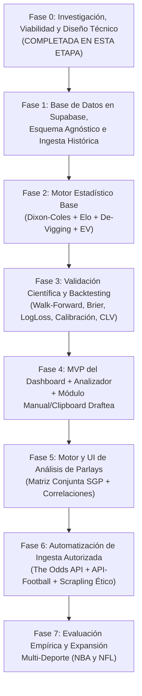

# 08. Roadmap y Plan de Implementación por Fases

## 1. Clasificación del Documento
- **Estructura Aprobada:** Ejecución secuencial en 7 fases con compuertas de calidad (*Quality Gates*) estrictas. Ninguna fase posterior se inicia sin cumplir los criterios de aceptación de la fase previa.

---

## 2. Diagrama de Dependencias entre Fases

---

## 3. Especificación Detallada por Fase

### Fase 0: Investigación, Viabilidad y Documentación Arquitectónica (Actual)
- **Objetivos:** Auditar fuentes de datos, definir modelos matemáticos, diseñar el esquema en Supabase y documentar la arquitectura completa sin escribir código de aplicación.
- **Entregables:** `README.md` y documentos `docs/01_VISION_Y_ALCANCE.md` a `docs/10_DECISIONES_PENDIENTES.md`.
- **Criterio de Avance a Fase 1:** Revisión y aprobación explícita del plan por parte del usuario.

---

### Fase 1: Fundamentos de Persistencia en Supabase e Ingesta de Datos Históricos
- **Objetivos:** Inicializar el backend en Python (`FastAPI` + `SQLModel` + `Alembic`), conectar con el proyecto en **Supabase (PostgreSQL)** y poblar un dataset histórico limpio, normalizado y reproducible de las 5 competiciones de fútbol (**Liga MX, LaLiga, Premier League, Champions League y MLS**).
- **Dependencias:** Fase 0 aprobada y credenciales de conexión de Supabase (`DATABASE_URL` en `.env`).
- **Requisitos Técnicos:**
  - Creación de tablas `competitions`, `teams`, `team_aliases`, `matches` y `odds_snapshots`.
  - Servicio `EntityResolver` para unificar nombres de clubes entre `Football-Data.co.uk`, `ClubElo` y `API-Football`.
  - Ingestador de CSVs históricos de `Football-Data.co.uk` (incluyendo momios históricos de apertura/cierre de Pinnacle y promedio de mercado) y ratings históricos de `ClubElo`.
- **Entregables:**
  - Migración inicial de Alembic aplicada en Supabase.
  - CLI/Script reproducible de carga histórica (`python -m app.ingestion.seed_historical`).
  - Reporte de integridad de datos (conteo de partidos por liga y temporada, verificación de 0 duplicados y 0 fechas inválidas).
- **Pruebas Necesarias:**
  - Tests unitarios de normalización de nombres de equipos y conversión de zonas horarias a UTC.
  - Test de idempotencia (ejecutar dos veces la ingesta histórica no duplica partidos ni snapshots de momios).
- **Riesgos:** Diferencias de nomenclatura en equipos de Liga MX y MLS. Mitigado con diccionario semilla de alias canónicos.
- **Esfuerzo Estimado:** 2 a 3 sesiones de trabajo.
- **Condición para Avanzar a Fase 2:** Al menos 3 a 5 temporadas completas cargadas en Supabase con resultados y momios de referencia verificados.

---

### Fase 2: Motor Estadístico y Cuantitativo Base
- **Objetivos:** Implementar la matemática pura y auditable del sistema: modelo **Dixon-Coles** con decaimiento temporal, sistema **Elo dinámico**, generador de matriz $10 \times 10$ de goles, métodos de **De-vigging (Shin, Power, Multiplicativo)**, cálculo de **$EV$ conservador** e intervalos de incertidumbre.
- **Dependencias:** Fase 1 completada.
- **Requisitos Técnicos:**
  - Implementación de `DixonColesEloModel` con optimización de máxima verosimilitud restringida (`scipy.optimize.minimize` con método `SLSQP` / `L-BFGS-B`).
  - Derivación exacta de mercados `1X2`, `Doble Oportunidad`, `Over/Under 2.5` y `BTTS` desde la matriz conjunta.
  - Módulo cuantitativo `quant_engine.py` con Shin/Power de-vigging y Kelly fraccionario con tope del 3%.
- **Entregables:**
  - Paquete `backend/app/analytics/` completamente tipado y documentado.
- **Pruebas Necesarias:**
  - Suite `pytest` matemática: verificar que $\sum_{i,j} P(X=i, Y=j) = 1.0 \pm 10^{-6}$, que $P(1X) = P(1) + P(X)$, que el método de Shin devuelve suma de probabilidades justas $= 1.0$, y que cuando $\rho = 0$ Dixon-Coles converge exactamente a Poisson independiente.
- **Esfuerzo Estimado:** 3 sesiones de trabajo.
- **Condición para Avanzar a Fase 3:** 100% de los tests matemáticos en verde y tiempos de ajuste por liga menores a 5 segundos.

---

### Fase 3: Validación Científica y Motor de Backtesting Walk-Forward
- **Objetivos:** Evaluar empíricamente el motor de la Fase 2 sobre los datos históricos de la Fase 1 sin fuga de información futura, calibrar probabilidades (`Isotonic` / `Platt`) y comparar contra los 3 benchmarks obligatorios.
- **Dependencias:** Fase 2 completada.
- **Requisitos Técnicos:**
  - Implementación del motor `WalkForwardEvaluator` con corte estricto `kickoff_time`.
  - Cálculo de *Brier Score*, *Log-Loss*, *RPS*, *Expected Calibration Error (ECE)*, *Closing Line Value (CLV)* y test de Diebold-Mariano.
  - Persistencia de corridas de validación en Supabase para ser consultadas desde el Laboratorio Estadístico.
- **Entregables:**
  - Módulo `backend/app/backtesting/` y primer reporte científico real sobre Liga MX, LaLiga, Premier League, Champions y MLS.
- **Pruebas Necesarias:**
  - **Test Automático Anti-Leakage:** Inyectar un partido futuro con resultado extremo (`99-0`) y demostrar mediante un test unitario que los parámetros entrenados para una fecha anterior permanecen idénticos hasta el 6to decimal.
- **Esfuerzo Estimado:** 2 a 3 sesiones de trabajo.
- **Condición para Avanzar a Fase 4:** Verificación de cero *data leakage*, curvas de calibración generadas y métricas documentadas por liga.

---

### Fase 4: MVP del Dashboard, Comparador de Momios y Módulo Draftea
- **Objetivos:** Construir los endpoints REST en FastAPI y la aplicación Frontend en **React + TypeScript + Vite + Tailwind + shadcn/ui + Recharts** con el Panel Principal, Explorador de Partidos, Comparador de Momios (con **Entrada Manual + Clipboard Parser para Draftea**), Analizador de Apuestas Individuales y Laboratorio Estadístico.
- **Dependencias:** Fase 3 completada.
- **Entregables:**
  - API REST documentada con OpenAPI y Frontend funcional conectado a Supabase vía FastAPI.
  - Parser inteligente de portapapeles para capturar cuotas de Draftea en segundos con validación de margen en vivo.
- **Pruebas Necesarias:**
  - Tests de endpoints con `TestClient` de FastAPI, tests unitarios del *Clipboard Parser* con distintos formatos de texto (cuotas decimales y americanas), y verificación de compilación TypeScript (`tsc --noEmit`).
- **Esfuerzo Estimado:** 3 a 4 sesiones de trabajo.
- **Condición para Avanzar a Fase 5:** Flujo completo de punta a punta: seleccionar un partido $\to$ pegar cuotas de Draftea $\to$ ver probabilidad justa (Shin) vs. probabilidad Dixon-Coles con intervalo de confianza $\to$ auditar $EV$ y factores explicativos.

---

### Fase 5: Módulo de Análisis de Parlays y Detección de Correlaciones
- **Objetivos:** Incorporar el motor matemático y la interfaz del **Constructor y Auditor de Parlays**, calculando probabilidades conjuntas exactas en *Same-Game Parlays* mediante la matriz $M_{10 \times 10}$ y cuantificando la erosión por margen compuesto en combinadas multi-partido.
- **Dependencias:** Fase 4 completada.
- **Pruebas Necesarias:**
  - Tests de detección de selecciones mutuamente excluyentes (ej. `Under 1.5` + `BTTS Sí` debe arrojar $P = 0$ y bloquearse) y tests de correlación positiva/negativa en el mismo partido.
- **Esfuerzo Estimado:** 2 sesiones de trabajo.
- **Condición para Avanzar a Fase 6:** Constructor de parlays operativo en el dashboard mostrando comparativa de riesgo individual vs. combinado.

---

### Fase 6: Conectores Automatizados de Fuentes Autorizadas y Control de Cuotas
- **Objetivos:** Integrar los conectores de **The Odds API** (500 req/mes), **API-Football** (100 req/día) y `Scrapling` (solo para descarga adaptativa de fuentes públicas permitidas) con controladores estrictos de presupuesto de peticiones (*Rate & Quota Budget Manager*) en Supabase.
- **Dependencias:** Fase 5 completada.
- **Esfuerzo Estimado:** 2 sesiones de trabajo.
- **Condición para Avanzar a Fase 7:** Sincronización controlada de partidos próximos con registro de cuota de API consumida en el Panel Principal.

---

### Fase 7: Evaluación Empírica Continua y Expansión a NBA y NFL
- **Objetivos:** Auditar el desempeño *forward-testing* de los modelos de fútbol y activar en la base de datos y el motor estadístico los módulos de **NBA** y **NFL** (modelos de *Point Spread / Handicap* y *Total Points* basados en distribuciones normales/t-Student ajustadas por ritmo de posesiones y eficiencia ofensiva/defensiva).
- **Dependencias:** Fase 6 completada y estabilidad verificada del MVP de fútbol.
